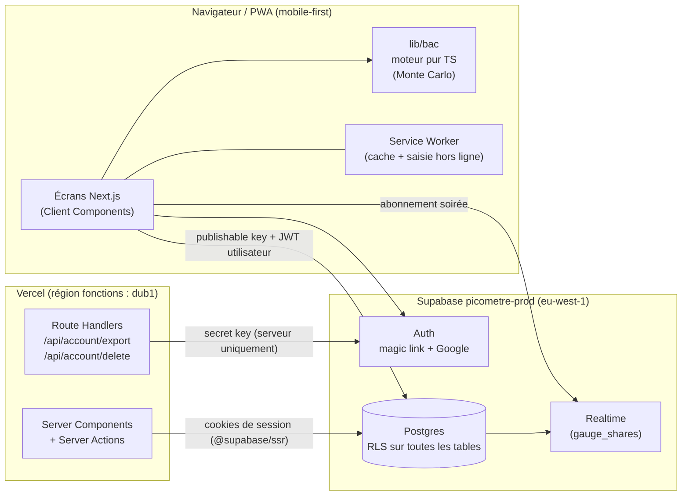
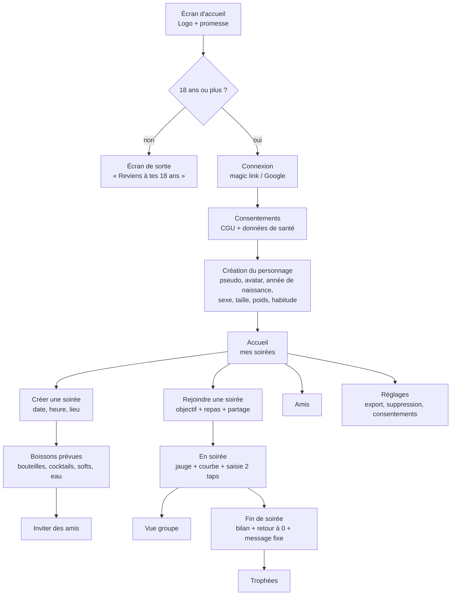

# PLAN — Picomètre

> Étape 1 : plan uniquement, aucun code. Chaque lot démarre après ton « go ».
> Référence scientifique : [`docs/parametres-scientifiques.md`](docs/parametres-scientifiques.md) (identifiants `P-xx`).
> Référence UI et sécurité : [`docs/charte-picometre.md`](docs/charte-picometre.md). Le §9 prime sur tout le reste.

## 0. Décisions déjà prises (étape 0)

| Sujet | Décision | Conséquence |
|---|---|---|
| Dépôt | `leoftz/picometre`, **public**, ruleset `protect-main` (PR obligatoire, historique linéaire, squash ou rebase) | Aucun secret ni donnée réelle dans le dépôt, jamais |
| Supabase | **Un seul projet** `picometre-prod`, région **eu-west-1 (Irlande, UE)** | Pas de staging. Les migrations sont poussées en prod **après le merge** dans `main` |
| Tests | Validation **en local** (stack Supabase via OrbStack) avant chaque commit et push | Les E2E et les données de test ne tournent qu'en local |
| Previews Vercel | Branchées sur la base de prod, **clé publishable seulement**, protégées par Vercel Authentication | Une preview qui contient une migration non appliquée peut être incomplète. La preview sert à valider l'UI, le local sert à valider le fonctionnel |
| Auth | Magic link et Google (scopes `openid email profile`) | L'app Google est en mode « Testing » jusqu'à sa publication (lot 10) |

---

## 1. Architecture



**Principes :**
- **Le calcul se fait sur l'appareil.** `lib/bac` tourne dans le navigateur. Le poids, la taille et le détail des consommations ne quittent la base que pour l'appareil de leur propriétaire.
- **La vue groupe reçoit uniquement des niveaux.** Chaque appareil publie dans `gauge_shares` son niveau de jauge (1 à 4) et le calendrier de ses prochains changements de niveau. Il le fait seulement si son propriétaire a consenti au partage pour cette soirée. Aucune valeur en g/L ni aucun poids n'est partagé, ce qui respecte la minimisation. Le calendrier permet aux autres de voir la jauge redescendre même quand l'app du participant est fermée.
- **La secret key ne sert qu'à deux Route Handlers** : la suppression du compte (`auth.admin.deleteUser`) et éventuellement l'export. Elle n'existe qu'en Production, avec l'import `server-only`. L'export passe de préférence par la session de l'utilisateur, donc par la RLS.
- **Région des fonctions Vercel** : `dub1` (Dublin), à côté de la base en Irlande. Ça évite de faire transiter les données par les États-Unis (la région par défaut est `iad1`).
- **Arborescence cible :**
  - `app/` : routes ;
  - `lib/bac/` : moteur pur, sans import d'UI ni de base ;
  - `lib/supabase/` : clients serveur et navigateur ;
  - `config/objectifs.ts` : seuils commentés avec les `P-xx` ;
  - `supabase/migrations/` ;
  - `tests/e2e/` : Playwright ;
  - `lib/bac/__tests__/` : Vitest.

### Moteur `lib/bac` (contrat)

```
simulate(profile, intakes[], meals[], objective, now, seed) → {
  curve: { t, p5, p50, p95 }[]          // pas de 5 min (P-30)
  peak, below05, below02, backToZero    // chacun avec p5/p50/p95 (P-37)
  level: 1..4                           // sur p50 (P-40..P-43)
  nextDrinkAt: Date | null              // règle P-51..P-53, null si Stop
  alerts: ('stop' | 'pause' | 'next' | 'cap')[]   // P-54..P-57
}
```

Ce sont des fonctions pures et déterministes (graine fixe, P-36). Les tests C-1 à C-3 reproduisent les cas du PDF. La performance visée est inférieure à 50 ms sur mobile (1 000 tirages × ~150 pas), sinon le calcul passe dans un Web Worker.

---

## 2. Modèle de données

Toutes les tables sont en `public`, avec RLS **activée et forcée**. Les clés étrangères vers `auth.users` sont en `on delete cascade`, pour que la suppression du compte efface tout en un clic.

| Table | Colonnes principales | Notes |
|---|---|---|
| `profiles` | `id` (= auth.users.id), `pseudo` (unique, 3 à 20 caractères), `avatar` (identifiant d'un avatar prédéfini), `birth_year`, `adult_confirmed_at`, `created_at` | Pas de photo, pas de date de naissance complète (P-09) |
| `profile_health` | `user_id` (PK), `sex` (`f`/`m`/`autre`), `height_cm`, `weight_kg`, `habit` (`occasionnel`/`regulier`/`frequent`), `updated_at` | **Donnée de santé** (RGPD, art. 9) : table séparée, lisible par son propriétaire seulement |
| `consents` | `id`, `user_id`, `kind` (`cgu`, `health_data`, `gauge_sharing`), `party_id` (nullable), `version`, `granted_at`, `revoked_at` | Journal des consentements, preuve exigée par le RGPD |
| `friendships` | `id`, `requester_id`, `addressee_id`, `status` (`pending`/`accepted`/`declined`), `created_at`, `responded_at` | Unicité sur la paire, quel que soit le sens |
| `friend_invites` | `token` (aléatoire), `inviter_id`, `expires_at`, `used_by`, `used_at` | Invitation par lien, à usage unique, expire après 7 jours |
| `parties` | `id`, `host_id`, `title`, `starts_at`, `location` (nullable), `status` (`planned`/`live`/`ended`), `ended_at` | |
| `party_participants` | `party_id`, `user_id`, `role` (`host`/`guest`), `invite_status`, `objective` (`desinhibe`/`zero_gdb`/`festive`), `meal_kind` (`aucun`/`collation`/`repas`), `meal_at`, `share_gauge` (bool), `stop_locked_at` | PK `(party_id, user_id)`. `share_gauge` est faux par défaut |
| `drink_types` | `id`, `slug`, `label`, `family` (`biere`/`cidre`/`vin`/`effervescent`/`aperitif`/`spiritueux`/`liqueur`/`cocktail`/`soft`/`eau`), `abv_default`, `abv_min`, `abv_max`, `param_ref` (ex. `P-60`), `sort` | **Banque de référence** (P-60 à P-78), alimentée par une migration de données, en lecture seule pour tous |
| `glass_sizes` | `id`, `slug`, `label`, `volume_ml`, `param_ref` (ex. `P-90`) | **Banque de référence** (P-80 à P-91), en lecture seule |
| `drink_type_glasses` | `drink_type_id`, `glass_size_id`, `is_default` | Verres proposés pour chaque type (★ = par défaut) |
| `party_drinks` | `id`, `party_id`, `drink_type_id`, `label` (facultatif, générique), `abv` (borné à la plage du type, par contrainte CHECK et trigger), `default_glass_id`, `pour` (`dose`/`oeil`) | Boissons prévues pour la soirée, choisies dans la banque. Sans marque (loi Évin) |
| `cocktail_ingredients` | `id`, `party_drink_id`, `drink_type_id`, `volume_ml`, `abv` | Un cocktail est une recette d'ingrédients tirés de la banque. `ethanol_g` recalculé par trigger (P-01, P-03) |
| `consumptions` | `id`, `party_id`, `user_id`, `party_drink_id`, `glass_size_id`, `volume_ml`, `abv`, `ethanol_g` (**figés au moment de la saisie**), `consumed_at`, `client_id` (idempotence hors ligne) | Visible par son propriétaire seulement. Volume et degré sont recopiés pour que l'historique ne change jamais |
| `alerts` | `id`, `party_id`, `user_id`, `kind`, `payload` (jsonb), `created_at`, `seen_at` | Historique pour le bilan |
| `gauge_shares` | `party_id`, `user_id`, `level` (1 à 4), `schedule` (jsonb : `[{at, level}]`), `computed_at` | Publiée dans Realtime. **Aucune valeur en g/L** |
| `trophies` | `id`, `party_id`, `user_id`, `kind` (`capitaine`/`joker_eau`/`atterrissage`), `awarded_at` | Lot 9 |

### Politiques RLS

Deux fonctions `security definer` (avec `search_path` fixé) servent de briques communes : `is_party_member(party_id)` et `are_friends(a, b)`.

| Table | SELECT | INSERT / UPDATE / DELETE |
|---|---|---|
| `profiles` | Soi-même, ses amis acceptés, les membres d'une même soirée (pseudo et avatar seulement, via la vue `public_profiles`) | Soi-même |
| `profile_health` | **Soi-même uniquement** | Soi-même |
| `consents` | Soi-même | INSERT et UPDATE (révocation) par soi-même. Pas de DELETE, sauf par cascade |
| `friendships` | Les deux parties | INSERT par le demandeur. UPDATE `status` par le destinataire seulement. DELETE par l'une ou l'autre |
| `friend_invites` | L'invitant | INSERT par l'invitant. L'utilisation passe par une RPC `accept_friend_invite(token)` |
| `parties` | Les membres | INSERT par soi (host = soi). UPDATE et DELETE par l'hôte |
| `party_participants` | Les membres de la soirée | INSERT par l'hôte, et seulement pour ses amis acceptés. UPDATE de sa propre ligne (objectif, repas, `share_gauge`). L'hôte peut retirer un invité |
| `drink_types`, `glass_sizes`, `drink_type_glasses` | Tout utilisateur authentifié | Aucune écriture côté client. Modification uniquement par migration |
| `party_drinks`, `cocktail_ingredients` | Les membres | INSERT, UPDATE et DELETE par l'hôte. Les membres peuvent ajouter une boisson pendant la soirée (voir question Q-12) |
| `consumptions`, `alerts` | **Soi-même uniquement** | Soi-même, et seulement si l'on est membre de la soirée |
| `gauge_shares` | Soi-même, ou un membre de la soirée **si** `share_gauge = true` pour cette ligne | UPSERT par soi-même uniquement, seulement si `share_gauge = true` |
| `trophies` | Les membres de la soirée | Attribution par une RPC `security definer` en fin de soirée, jamais par écriture directe |

**Tests RLS (exigés pour chaque lot) :** des tests SQL avec pgTAP (`supabase test db`) sur la stack locale. On crée trois utilisateurs (A, B ami de A, C inconnu) et on vérifie :
- C ne lit rien de A ;
- B ne lit jamais `profile_health` ni les `consumptions` de A ;
- B ne voit le niveau de A que si A a activé `share_gauge` ;
- la révocation du partage prend effet immédiatement.

---

## 3. Écrans et parcours utilisateur

Mode sombre par défaut, police Baloo 2 pour les titres et Inter pour l'interface. Bouton « Joker eau » toujours visible pendant la soirée. Les textes respectent la checklist §12 de la charte (tutoiement, 20 mots maximum par phrase, un seul point d'exclamation par phrase).



| # | Écran | Points clés |
|---|---|---|
| E1 | Barrière d'âge | Affichée avant toute chose. Âge déclaratif, avec la mention « Picomètre est réservé aux 18 ans et plus » |
| E2 | Connexion | Deux boutons : « Recevoir un lien » et « Continuer avec Google » |
| E3 | Consentements | Explication courte et claire de pourquoi on demande poids, taille et sexe. Case **non pré-cochée** pour les données de santé |
| E4 | Personnage | Avatars prédéfinis (formes rondes, charte §7). Contrôles : poids de 35 à 250 kg, taille de 130 à 230 cm. Rappel : « On ne garde que l'année » |
| E5 | Accueil | Soirées à venir, en cours et passées, et un bouton primaire « Créer une soirée » |
| E6 | Création de soirée | Date et heure, lieu facultatif |
| E7 | Boissons prévues | Choix dans la **banque** : famille (bière, vin, spiritueux…), puis type (IPA, triple, rosé…). Degré par défaut ajustable dans la plage du type, verre par défaut, service « dosé » ou « à l'œil ». Constructeur de cocktail à partir d'ingrédients de la banque. L'équivalence en verres standard s'affiche sobrement (« ≈ 2 verres standard »), sans valoriser l'alcool |
| E8 | Invitations | Liste d'amis à cocher |
| E9 | Rejoindre | Choix de l'objectif (3 cartes), repas (aucun, collation ou repas, et l'heure), interrupteur « Partager ma jauge avec le groupe » désactivé par défaut |
| E10 | En soirée | Jauge (anneau, libellé, icône, valeur médiane, fourchette, mention « estimation »), courbe p5/p50/p95 avec repère « maintenant », alertes. **Saisie en 2 taps** :
1. tap sur la boisson (grille des boissons prévues de la soirée, eau en premier) ;
2. tap sur le **verre** (les verres proposés pour ce type, le verre par défaut mis en avant : shot, demi, pinte…).

Chaque bouton de verre affiche son équivalence (« ≈ 2 verres standard »). Annulation possible pendant 10 s. Ajout d'une boisson hors liste via la banque (Q-12) |
| E11 | Vue groupe | Pseudo, avatar, libellé et couleur de niveau, icône. Rien pour ceux qui ne partagent pas (« jauge privée ») |
| E12 | Fin de soirée | Pic estimé et sa fourchette, heure estimée de retour à 0, objectif tenu ou non, message fixe de la charte §9.5 |
| E13 | Trophées | Capitaine de soirée, joker eau, atterrissage parfait |
| E14 | Amis | Ajout par pseudo ou par lien, demandes reçues (accepter / refuser) |
| E15 | Réglages | Modifier le profil, révoquer les consentements, **exporter mes données** (JSON), **supprimer mon compte** (une confirmation, puis suppression immédiate et définitive) |
| E16 | Pages légales | Mentions légales, politique de confidentialité, limites de l'outil (PDF p. 9) |

---

## 4. Lots livrables

Chaque lot suit le même cycle :
1. branche depuis `feature/picometre-init` ;
2. migrations versionnées ;
3. code et tests ;
4. commits Conventional Commits ;
5. PR (description, captures, checklist) ;
6. validation en local, puis preview pour l'UI.

| Lot | Contenu | Dépend de | Complexité |
|---|---|---|---|
| **L1 — Socle** | Next.js (App Router, TS strict), Tailwind avec les jetons de la charte, polices, manifest PWA et icônes générées depuis `picometre-icone.svg`, clients `@supabase/ssr`, ESLint, Vitest et Playwright configurés, CI GitHub Actions (lint, typage, tests), `vercel.json` (région `dub1`) | — | M |
| **L2 — Moteur `lib/bac`** | Moteur pur : Watson, F, ka, β, élimination saturable, Monte Carlo, prochain verre, niveaux, alertes. `config/objectifs.ts`. Tests C-1 à C-3 et cas limites (0 verre, eau seule, Stop définitif, profil « autre », profil fréquent plafonné) | L1 | **L** |
| **L3 — Compte et RGPD** | Barrière d'âge, auth (magic link et Google), consentements, création du personnage, migrations `profiles`, `profile_health`, `consents`, RLS et pgTAP, export JSON, suppression du compte | L1 | M |
| **L4 — Banque de verres et soirée (solo)** | Migration de la **banque** (`drink_types`, `glass_sizes`, `drink_type_glasses`, alimentées depuis P-60 à P-91) avec un test qui vérifie chaque valeur contre `parametres-scientifiques.md`. Créer une soirée, boissons prévues choisies dans la banque, cocktails, rejoindre (objectif, repas). Migrations et RLS | L3 | M/L |
| **L5 — Saisie et jauge** | Saisie en 2 taps (avec tolérance hors ligne), jauge, courbe et fourchette, recalcul en direct | L2, L4 | M/L |
| **L6 — Alertes et bilan** | Prochain verre, Pause fraîcheur, Stop définitif, fin de soirée, message fixe | L5 | M |
| **L7 — Social** | Amis (pseudo et lien), invitations aux soirées | L3 | M |
| **L8 — Vue groupe temps réel** | Consentement par soirée, `gauge_shares` et calendrier, Realtime, révocation | L6, L7 | M |
| **L9 — Trophées** | Attribution par RPC en fin de soirée, écran dédié | L8 | S |
| **L10 — Durcissement et mise en ligne** | SMTP dédié, publication de l'app Google, pages légales, audit d'accessibilité (WCAG AA), en-têtes de sécurité (CSP), passage de Supabase en plan payant | Tous | M |

| **L11 — Recettes de cocktails** | Tables `cocktail_recipes` et `cocktail_recipe_ingredients` (en lecture seule, alimentées depuis R-01 à R-55). Bibliothèque proposée dans l'écran E7 uniquement, avec la version sans alcool à côté de chaque recette. Ajout en un tap aux boissons prévues | L4 | S/M |

Le **MVP** couvre L1 à L6 : profil → soirée → saisie → jauge → alertes.

---

## 5. Risques et parades

| Risque | Type | Parade |
|---|---|---|
| L'estimation est prise pour une autorisation de conduire | Sécurité, juridique | Aucun seuil de conduite affiché (N-6), mention « estimation » partout, message fixe en fin de soirée, test E2E qui recherche les mots interdits (« conduire » hors du message fixe, « tu peux reprendre le volant »…) |
| Précision limitée (±20 à 40 %), paramètres hors PDF (ka, fenêtre de repas) | Calcul | Prochain verre décidé sur le **p95**, Stop définitif, β « fréquent » plafonné (P-23), fourchette toujours affichée, tests C-1 à C-3 |
| Jeu détourné (« qui atteint le Stop ») | Sécurité (§9) | Aucun classement ni trophée lié à la quantité, la vue groupe ne montre que des niveaux, aucun son ni confetti au Stop |
| Données de santé (art. 9 RGPD) | RGPD | Consentement explicite distinct, table isolée, minimisation (année de naissance, pas de photo), export et suppression, région UE pour Supabase et Vercel, journal des consentements. **Une AIPD (analyse d'impact) est probablement requise** : je fournirai un modèle |
| Base de prod partagée par les previews | Technique, RGPD | Clé publishable seulement, Vercel Authentication sur les previews, aucune donnée de test en prod, migrations seulement après le merge |
| Projet Supabase Free mis en pause après 7 jours d'inactivité | Disponibilité | Acceptable pendant le développement. **Plan Pro avant l'ouverture au public** (L10) |
| Limite d'envoi des e-mails Supabase | Disponibilité | SMTP dédié avant l'ouverture (L10) |
| Loi Évin : marques, présentation attractive de l'alcool | Conformité | Types génériques, libellé libre limité et filtré (Q-10), aucune image de bouteille, ton charte §9.8 |
| Mineurs | Conformité | Barrière d'âge déclarative, pas de contenu ciblant les mineurs. Les limites de cette vérification déclarative sont à documenter (Q-1) |
| Stores (si l'app est empaquetée plus tard) | Conformité | La PWA seule n'est pas concernée. Apple et Google exigent une classification 17+/18+ et refusent les apps qui encouragent la consommation : à revoir avant tout empaquetage |
| Horloge, fuseaux horaires, saisie hors ligne | Technique | `consumed_at` horodaté sur l'appareil et stocké en UTC, `client_id` pour l'idempotence, recalcul au retour du réseau |
| Performance du Monte Carlo sur mobile | Technique | Mesure dès L2, Web Worker si plus de 50 ms |

---

## 6. Questions ouvertes à trancher

### Paramètres « hors PDF — à valider » (voir `docs/parametres-scientifiques.md`)
- **Q-P1** — Absorption : ka = 6 h⁻¹ à jeun, 4 avec collation, 2 avec repas (P-16 à P-18), variabilité CV 30 % (P-19).
- **Q-P2** — Fenêtre d'effet d'un repas : de −30 min à +3 h pour un repas, de −30 min à +1 h 30 pour une collation (P-20).
- **Q-P3** — Forme du ralentissement sous 0,2 g/L : vitesse proportionnelle à C (P-28). Seuil de retour à zéro : 0,01 g/L (P-38).
- **Q-P4** — Profil « fréquent » : on applique le β du profil régulier, par prudence (P-23).
- **Q-P5** — Sexe « autre » : on applique la formule femme (P-08).
- **Q-P6** — Variabilité : poids déclaré CV 5 % (P-34), variabilité de F (P-13), troncature de β (P-25), 1 000 tirages (P-36).
- **Q-P7** — Seuils des objectifs : p95 < 0,5 / < 0,5 avec 2 verres maximum / < 0,8 (P-51 à P-53). « Désinhibé » et « Zéro gueule de bois » ne diffèrent que par le plafond de 2 verres : est-ce que ça te va ?
- **Q-P8** — Stop **définitif** pour la soirée une fois 0,8 g/L atteint (P-54), et sur le p50. Faut-il aussi déclencher le Stop quand le **p95** atteint 0,8 ?

### Produit et charte
- **Q-1** — Vérification de l'âge : la déclaration (année de naissance et case à cocher) suffit-elle pour le MVP ? Une vérification réelle (pièce d'identité, tiers de confiance) est coûteuse.
- **Q-2** — La charte décrit un **jeu de cartes** (gorgées, défis). Le confirmes-tu hors périmètre ? On ne garde que l'identité, la jauge, le ton et le §9.
- **Q-3** — Au niveau 3, la charte (§9, règle 4) dit « plus de carte gorgées ». Pour l'objectif « Soirée festive », on continue d'afficher l'heure du prochain verre au niveau 3, accompagnée de « Pause fraîcheur conseillée » ? Ou bien on ne l'affiche plus du tout à partir du niveau 3 ?
- **Q-4** — Le trophée « **Roi** du joker eau » est genré : on le renomme « **Pro** du joker eau » ou « **As** du joker eau » ?
- **Q-5** — Le trophée « Capitaine de soirée » (jauge la plus basse) ne concerne que les participants qui partagent leur jauge. Est-ce que ça te convient ?
- **Q-6** — Vue groupe : on montre uniquement le niveau (libellé, couleur, icône), jamais de valeur en g/L. Est-ce que ça te convient ?
- **Q-7** — Variant ALDH2 : on affiche un message générique (N-1) sans rien collecter ?

### RGPD et exploitation
- **Q-8** — Durée de conservation : on supprime automatiquement le détail des consommations **90 jours** après la fin de la soirée, en ne gardant que le bilan ? Ou une autre durée ?
- **Q-9** — SMTP dédié pour les magic links (Brevo, entreprise française, ou Resend en région UE) : lequel, et à partir de quand ?
- **Q-10** — Boissons prévues : liste fermée de types génériques, ou libellé libre (avec un risque de noms de marques) ?
- **Q-11** — Éditeur et hébergeur pour les mentions légales : qui est le responsable du traitement (toi en nom propre, ou une structure) ?
- **Q-12** — Les invités peuvent-ils ajouter une boisson non prévue pendant la soirée, ou seul l'hôte le peut-il ?

### Banque de verres — tranchées le 13/10/2026
- ✅ **Q-13** — Types, degrés, plages (P-60 à P-79) et contenances (P-80 à P-91) validés. Ajouts : plage des spiritueux étendue à 50 % (rhum agricole) et type « bitter léger » (P-79), nécessaires pour les recettes.
- ✅ **Q-14** — Service « à l'œil » : CV volume de 15 %.
- ✅ **Q-15** — Bouteille partagée : chacun saisit ses verres.
- ✅ **Q-16** — Bibliothèque de cocktails : oui, **en fonctionnalité ultérieure (L11)**. La liste proposée est R-01 à R-23 et R-50 à R-55 dans `parametres-scientifiques.md` §1.2. D'ici là, le constructeur du lot L4 suffit.
- ✅ **Q-17** — Liste et doses des cocktails (R-01 à R-23, R-50 à R-55) validées, ainsi que la règle « jamais pendant la soirée, masquée après un Stop, pas de recette ≥ 2,5 verres standard ».
